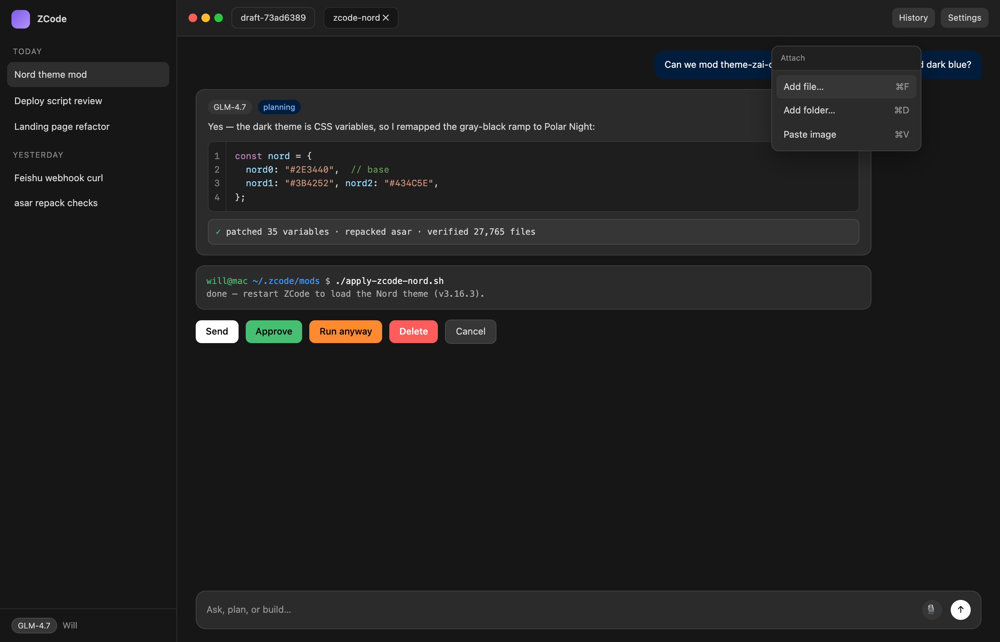
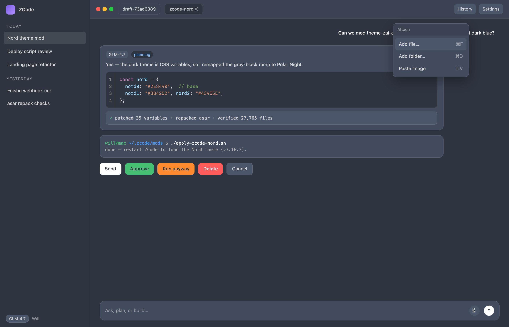

# ZCode Dark Theme — Nord Mod

An unofficial [Nord](https://www.nordtheme.com/) (Polar Night) color scheme for the **ZCode desktop app's dark mode**, applied by patching the app's `app.asar` stylesheet. No app binaries are modified — only CSS.

| Stock dark | Nord mod |
|---|---|
|  |  |

*Both screenshots are rendered with the app's own stylesheet (v3.16.3) — every surface color above is a real theme variable resolving exactly as it does in the app.*

The app's dark theme is a neutral gray-black ramp; this mod remaps it to Nord's four Polar Night blues while leaving the Light theme, text, and accent colors untouched.

| Original | Used for | Nord |
|---|---|---|
| `#101010`–`#161616` | base background, sidebar, composer | `#2E3440` (nord0) |
| `#202020` | header, panel, tabs | `#3B4252` (nord1) |
| `#2b2b2b` | cards, inputs, menus, popovers | `#434C5E` (nord2) |
| `#363636` | hover states, tags, terminal black | `#4C566A` (nord3) |

Also themed:

- **Code blocks** (Monaco editor background `#1e1e1e` → `#2E3440`)
- **Startup splash** gradient (black → Polar Night)
- Button foregrounds that were pure `#000` become nord0 — the canonical Nord pattern for text on colored surfaces

## Requirements

- macOS (the Windows app layout is not supported yet)
- [ZCode](https://zhipu.ai) desktop app — tested with **3.16.3**
- Node.js with `npx` (for `@electron/asar`)

## Quick start

```bash
git clone https://github.com/willio/zcode-dark-theme-nord-mod.git
cd zcode-dark-theme-nord-mod
./apply.sh
```

Then **restart ZCode** and set the theme to **Dark** (Settings → Appearance → Theme). The mod only affects dark mode.

`apply.sh`:

1. backs up your original `app.asar` to `~/.zcode/backup/app.asar.v<version>.bak` (once per app version)
2. extracts the asar, generates Nord overrides from your app's own theme CSS, and appends them between `ZCODE-NORD-MOD` markers
3. repacks the asar (keeping native modules unpacked), verifies the file tree and native set match what was installed, and only then swaps it in atomically

It is safe to re-run. Environment overrides: `ZCODE_APP` (default `/Applications/ZCode.app`), `ZCODE_BACKUP_DIR` (default `~/.zcode/backup`).

## After a ZCode app update

App updates replace `app.asar` and wipe the mod. Just run `./apply.sh` again — it backs up each new version's original before patching.

## Uninstall

```bash
./restore.sh
```

Restores the pristine `app.asar` backup for the installed version, then restart ZCode.

## How it works

- ZCode's dark theme is plain CSS custom properties under `.dark, .theme-zai-dark { --color-*: … }` inside `out/renderer/assets/styles-*.css` in the asar.
- `gen-nord.js` parses those rules, maps every literal dark color to a Polar Night shade by luminance band (alpha preserved), and emits override rules with `!important` appended to the same stylesheet — the original rules are kept intact.
- The mod does **not** need code re-signing: the app ships an `ElectronAsarIntegrity` hash in `Info.plist`, but the `EnableEmbeddedAsarIntegrityValidation` fuse is disabled, so Electron never verifies it. If a future ZCode version enables that fuse, this mod will stop working (the app would refuse to launch with a patched asar — `restore.sh` fixes that).

### Not themed (known limitations)

- Syntax **token** colors in code blocks (stock `vs-dark` highlights — readable on nord0)
- Inline JS-styled colors in the docx/pdf document viewers and the OS-level permission panel

## Troubleshooting

- **App won't start after applying** — run `./restore.sh`. This should not happen on app versions with the integrity fuse disabled, but the restore path is always available.
- **"unpacked native set differs" error** — a future app version changed which native modules ship unpacked. The script aborts without touching your app; please open an issue so the glob can be updated.

## Disclaimer

This is an unofficial community mod. It is not affiliated with or endorsed by Zhipu AI / ZCode. The Nord color palette is by [Arctic Ice Studio](https://github.com/arcticicestudio/nord) (MIT). Use at your own risk; the script always keeps a per-version backup for a clean revert.

## License

[MIT](LICENSE)
